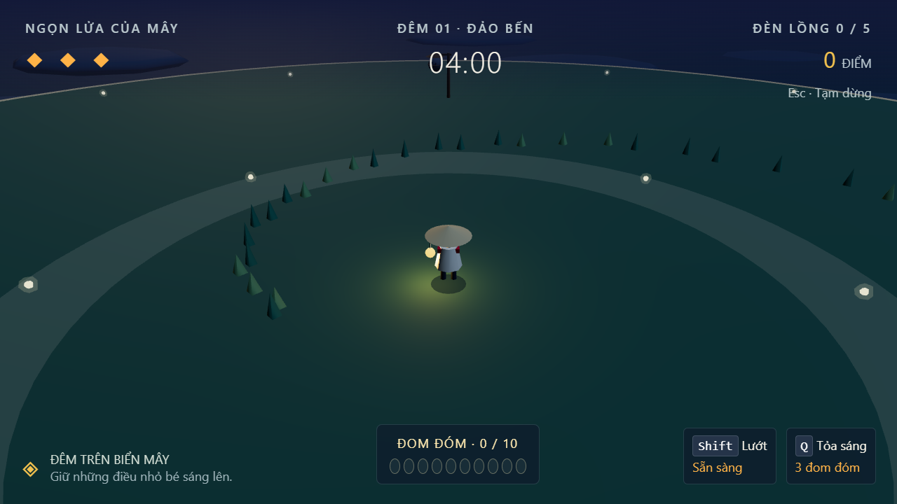

# Đảo Đèn Lồng

**[Video demo MP4](docs/demo/demo.mp4)** · [Bản phát hành v1.0.0](https://github.com/nguyenvandang2201/K5-L3A-DAY12-NguyenVanDang-2A202603371-AI-SDLC-Dao-Den-Long/releases/tag/v1.0.0)

**Nguyễn Văn Đăng · 2A202603371 · L3A** — Day12 AI SDLC Lab · Test Contract **1.3**.

Game3D góc nhìn thứ ba: Mây đội nón lá, gom đom đóm và giữ Đèn Lồng sáng tới bình minh giữa biển mây. Ba Đêm: Đảo Bến, Đảo Cau và Đảo Chuông; có Bóng Mực, Gió Lạc, bùa và bục nhảy. Logic hiển thị và headless dùng cùng một mô phỏng60Hz.



## Chạy trong 3 lệnh

Sau khi clone repo, mở terminal trong thư mục dự án:

```bash
npm ci
npm run build
npm start
```

Mở **http://127.0.0.1:5173**. `npm run dev` dùng khi phát triển. Mọi asset và âm thanh đều cục bộ, không cần API key/CDN.

Yêu cầu: Node.js≥22.12, npm, Windows/macOS/Linux, trình duyệt desktop hỗ trợ WebGL2 và bàn phím/chuột. Khuyến nghị GPU tích hợp tương đương Radeon780M, RAM8GB, màn hình1280×720 trở lên. Nếu WebGL không khả dụng, game hiện thông báo; CLI headless không cần GPU.

**ZIP dựng sẵn:** giải nén asset `dao-den-long-v1.0.0-web.zip` từ Release, chạy `node scripts/run.mjs`, mở địa chỉ trên. Không cần npm install cho ZIP. Không mở trực tiếp index.html bằng file://.

## Điều khiển và mục tiêu

| Hành động | Phím mặc định |
|---|---|
| Di chuyển theo camera | W/A/S/D |
| Nhảy / Lướt | Space / Shift trái |
| Nạp ánh sáng hoặc châm dầu | E |
| Tỏa Sáng | Q (tốn3đomđóm) |
| Tạm dừng | Esc hoặc P |
| Xoay camera | Giữ chuột phải và kéo |

Cài đặt có đổi cả9phím, báo trùng, khôi phục mặc định, âm lượng/độ nhạy, bảng màu dễ phân biệt, giảm chuyển động và chữ lớn×1.25. Lưu qua lần mở game.

Giữ ít nhất **3/5,4/6,5/7** đèn sáng khi bình minh tới trong **240/270/300giây**. Thắp đủ không thắng sớm. Hết Ngọn Lửa luôn thua. Đèn100dầu, hao1/s; dưới30 mất vùng an toàn và có thể bị shade hút thêm5/s/con. Thắp đầu cần10mote, thắp lại5; E khi đèn sáng châm10dầu/mote. Sức chứa10, tăng2 mỗi lần thắp, tối đa20. Gió Lạc cướp đồ; pulse khi nó đang bỏ chạy lấy lại đồ.

Điểm: +5/mote nạp; +100thắp đầu/+40thắp lại; pulse+5/shade hoặc+15 nếu đang hút dầu. Khi thắng: mỗi đèn sáng+50+floor(fuel), mỗi Ngọn Lửa+50; không thưởng thời gian. Tổng hành trình **chỉ cộng các Đêm đã thắng**, chơi lại không cộng điểm Đêm thua. Sau thua hoặc thắng Đêm3 có thể nhập tên lưu top10.

## Test, bằng chứng và Test Contract

```bash
npm test
npm run verify -- --phase phase-4
npm run browser
```

Lệnh browser cần `npx playwright install chromium` lần đầu, và build trước đó. `npm test` tự chạy bằng Node, không cần browser/GPU. `verify` lưu stdout/stderr/exit code và dừng nếu một bước thất bại. CI kiểm tra trên Ubuntu/macOS.

```bash
node scripts/headless.mjs --seed 42 --night 1 --ticks 14400 --out run.jsonl --snapshot-every 10
node scripts/headless.mjs --seed 42 --night 2 --scenario docs/proof/phase-4/charm.scenario.json --ticks 60 --out charm.jsonl
node scripts/prove.mjs phase-4
```

Thêm `--inputs file.json` để phát input; `--night` nhận1/2/3. Snapshot0 trước input; inputk tạo trạng tháik+1; tọa độ3chữ số, fuel1chữ số. Input thiếu trường giữ giá trị cũ, nút theo cạnh false→true. Lỗi scenario/input/argument exit2, lỗi hệ thống exit1, thành công0. File khai báo và lệnh build/run/headless/bench/soak: [game.contract.json](game.contract.json).

| Phase | Contract | Bằng chứng | Ghi chép |
|---|---|---|---|
| phase-1 | 1.0 | [Logs,3scenario,ảnh](docs/proof/phase-1) | [Evaluation](docs/notes/phase-1.md) |
| phase-2 | 1.1 | [Logs,10scenario,ảnh](docs/proof/phase-2) | [Evaluation](docs/notes/phase-2.md) |
| phase-3 | 1.2 | [Logs,14scenario,ảnh](docs/proof/phase-3) | [Evaluation](docs/notes/phase-3.md),[ADR](docs/notes/ADR-001-fuel-and-dawn.md) |
| phase-4 | 1.3 | [Logs,14scenario,UI](docs/proof/phase-4) | [Evaluation](docs/notes/phase-4.md),[Retro](docs/notes/retro.md) |

Bằng chứng cũ chạy ở tag tương ứng. Phase3 thay luật thắng/điểm/thời lượng nên test cũ được cập nhật với lý do trong ADR; không skip âm thầm. Ảnh night2/3 dùng scenario QA có nhãn, không phải tuyên bố thắng tự nhiên. Video tách rõ lượt chơi và tình huống headless kiểm thử.

## Benchmark và soak

```bash
npx playwright install chromium
node scripts/bench.mjs --seed 42 --duration 30 --out bench.json
node --expose-gc scripts/soak.mjs --seed 7 --nights 10 --out soak.json
```

Benchmark mở Chromium1280×720, đầy đủ renderer chơi thật, 200shade/100mote/3đèn100dầu, camera15s/vòng, warmup3s rồi đo30s. Tắt spawn/hit/pickup/fuel/end; shade vẫn wander. Có `--headless true` hoặc `--software true` cho môi trường kiểm tra, phải ghi rõ khi dùng. Soak chạy10Đêm trong cùng process, seed7+i, xoay1→2→3, input ngẫu nhiên đúng xác suất ticket; RSS đo sau load đầu và reset cuối, không dùng heap JS thay thế.

Kết quả tham khảo trên **Ryzen7 H255 / Radeon780M / RAM30.8GiB / Windows**:

| Phép đo | Kết quả |
|---|---:|
| Benchmark FPS trung bình /1%low | khoảng120 /112FPS |
| p95 frame /load | 8.5ms /1246ms |
| Soak10Đêm | 0crash; RSS44.93→49.34MiB (+9.8%) |

Số gốc ở [bench.json](bench.json), [cấu hình máy](bench.environment.json), [soak.json](soak.json); đây không phải chứng nhận trên máy chấm giảng viên. Bản software7FPS giữ riêng trong proof để minh bạch. Browser không có API tắt vsync/đo RSS tiến trình: khai `vsync_off:false`, `peak_mem_mb:null` đúng ngoại lệ web.

## Bảng xếp hạng và xuất điểm

Tên3–12ký tự `[A-Za-z0-9_]`; top10 theo score giảm, bằng điểm theo thời điểm đạt sớm. Lưu name,score,nights_won,achieved_at cótimezone,seed. Chạy qua npmstart: server ghi nguyên tử vào `.local/leaderboard.json`; có thể đặt `DAO_DEN_LONG_DATA_DIR`. Web tĩnh dùng localStorage của cùng origin/browser.

```bash
node scripts/run.mjs --export-leaderboard out.json
```

Lệnh xuất đọc bảng trên đĩa do npmstart lưu, không cần mở browser. Với hosting tĩnh không có Node server, dùng cùng browser để xem bảng localStorage; CLI không truy cập được storage của một origin bất kỳ.

## Sáng tạo của tôi

Nón lá và đèn nhỏ của Mây, biển mây nhiều lớp, sao trời, cỏ low-poly và lời Ông Đăng tạo không khí cổ tích Việt Nam. Nhạc nền/hiệu ứng tổng hợp bằng Web Audio, không dùng bản ghi bên ngoài. Chi tiết trang trí không tạo entity headless và không xuất hiện thêm trong cảnh benchmark; test tất định chứng minh logic lõi giữ nguyên.

## Kiến trúc và tài liệu

`src/core`: mô phỏng thuần/tuning/map/validation/leaderboard; `src/view`: Three.js/audio/settings; `scripts`: CLI, kiểm chứng, đo và đóng gói; `tests`: assertions; `.agents/skills/verify-game` và `AGENTS.md`: harness; `docs`: spec/notes/proof/demo.

- [Yêu cầu, acceptance criteria và giả định](docs/spec/requirements.md)
- [Changelog4phase](CHANGELOG.md), [Credits](CREDITS.md), [License](LICENSE)
- [Đề bài gốc](docs/lab/README.md), [Guide](GUIDE.md), [Rubric](RUBRIC.md), [Submission](SUBMISSION.md), [Rules](RULES.md)

Tag tạo tuần tự sau kiểm chứng, theo thời gian triển khai thật, không backdate lịch lab. Chưa có bộ test ẩn hoặc review người khác; không khẳng định đã đạt hai phần này. Token/chi phí không có telemetry nên không điền số giả; retro ghi cách tiết kiệm.
